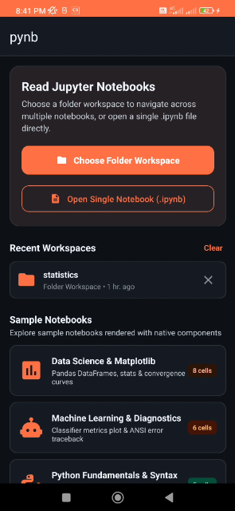
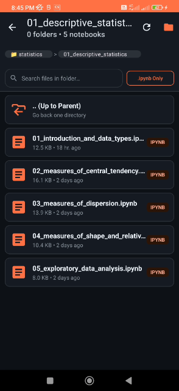

# 📓 pynb


&nbsp;&nbsp;
[](https://github.com/rootminusone8004/pynb/releases)
&nbsp;&nbsp;
[](https://github.com/rootminusone8004/pynb/actions/workflows/release.yml)


pynb is a fast, native **Jupyter Notebook (`.ipynb`)** reader, editor and runner for Android.

---

## 🎯 What is it?

**pynb** is a pure Java Android application for working with Jupyter notebooks on your phone. It renders notebooks with native Android views instead of a heavy WebView, so even long notebooks scroll smoothly. Some of its core features include:

- **Native Notebook Rendering** for Markdown, code, outputs, plots and tracebacks.
- **Math & Diagrams** with LaTeX formulas and Mermaid diagrams in Markdown cells.
- **Cell Editing** with Python highlighting, auto-indent and a coding key bar.
- **Run Python Cells** in a Termux `.venv` on your phone, or on your own server (AWS EC2, VPS…) over SSH.
- **Code Suggestions & Parameter Hints** from your live Python session.
- **Save Back to `.ipynb`** while keeping Jupyter's file format.
- **Folder Workspace** browsing with breadcrumbs, search and recent folders.
- **Private by Design**: no ads, no analytics, no tracking.

---

## 📱 Screenshots

<div style="display: flex; gap: 20px;">
  
  
</div>

---

## ✨ Features & Highlights

- 📖 **Native Notebook Reader**:

  - **Smooth Scrolling**: Every cell is a recycled native view (no WebView), so notebooks with hundreds of cells scroll at 60/120 FPS.
  - **Background Parsing**: Notebooks are parsed off the UI thread; large files open without freezing.
  - **Python Syntax Highlighting** with optional line numbers, and collapsible long code cells.
  - **Output Support**: `stdout` / `stderr` streams with ANSI colors, results (`text/plain`), colorized tracebacks, and PNG / JPEG figures from Matplotlib, Seaborn and friends.
  - **Fullscreen Image Viewer**: Tap a figure to pinch-zoom, pan and share it.
  - **Outline & Search**: Jump to any Markdown heading from the outline sheet, and search across all cells.

- 📝 **Markdown, Math & Diagrams**:

  - **Native Markdown** (via Markwon): headings, lists, tables, block quotes, code blocks, images and inline HTML.
  - **LaTeX Math**: Inline `$...$` and display `$$...$$`, `\[...\]` and `\begin{align}` equations, scaled to fit the screen.
  - **Mermaid Diagrams**: ` ```mermaid ` blocks render as flowcharts, sequence, class, state, Gantt and pie diagrams. Rendering is fully offline, follows the light/dark theme, and diagrams open in the zoomable viewer.
  - **Source / Rendered Toggle** and one-tap copy on every cell.

- ✏️ **Cell Editor**:

  - Full-screen editor for code and Markdown cells.
  - **Python highlighting** and **auto-indent** (a new line keeps the indentation and adds a level after `:`).
  - **Key bar** with indent / unindent and the symbols that are awkward on phone keyboards (`:`, brackets, quotes, `#`, `_`, operators…).
  - **Apply and run** to edit and execute a code cell in one step.

- ▶️ **Run Python Cells**:

  - **On your phone with Termux**: Connect to a Python `.venv` in [Termux](https://termux.dev) and run cells there.
  - **On a remote server over SSH**: Connect to a `.venv` on AWS EC2, a VPS or any Linux / macOS machine with a private key (`.pem`, ed25519, RSA, ECDSA, with passphrase) or a password.
    - The kernel listens only on the server's localhost and is reached through the SSH tunnel; only port 22 needs to be open.
    - It keeps running if the connection drops, and pynb reconnects to it with your variables intact.
    - Saved servers, encrypted credentials (Android Keystore) and host-key verification with a warning if a key changes.
  - **Jupyter-like Sessions**: Variables persist between cells; **Run All**, **Interrupt** and **Restart** are in the menu.
  - **Supported**: printed output, the value of the last line, `display()`, rich `_repr_*_` objects, Matplotlib figures, tracebacks, `!shell` commands, `%pip`, `%cd`, `%pwd`, `%time`, `%%bash` and `%%writefile`.

- 💡 **Code Suggestions & Parameter Hints**:

  - Suggestions come from the **connected Python session**, so they know what earlier cells defined: variables and their attributes (`df.` → `head`, `describe`…), functions, keywords, builtins and installed modules after `import`.
  - Typing `(` after a function shows its **parameters**, with the one you are typing highlighted (`range(1, ` → `range(start, stop[, step])`). The hint disappears when `)` closes the call.
  - Nothing extra is bundled in the app: suggestions use the Python standard library on the kernel side.

- 💾 **Save Back to `.ipynb`**:

  - **Save** writes edits and new outputs into the notebook; only changed cells are rewritten, and the file keeps Jupyter's own formatting.
  - **Save As…** for read-only files and the built-in samples.

- 📁 **Folder Workspace Explorer**:

  - Open any folder through Android's Storage Access Framework, then browse subfolders with **breadcrumbs**, **live search** and an **`.ipynb` only** filter.
  - **Recent files and folders** on the home screen; open `.ipynb` files from any file manager, browser or messenger.
  - Three **built-in sample notebooks** (data analysis, machine learning, Python tutorial).

---

## 🔒 Privacy & Permissions

| Permission                                   | Why it is needed                                                                       |
| :------------------------------------------- | :------------------------------------------------------------------------------------- |
| `INTERNET`                                   | Only for SSH connections to servers **you** add. Nothing else connects to the network. |
| `com.termux.permission.RUN_COMMAND`          | To start Python in Termux when you connect to a Termux `.venv`.                        |
| Storage Access Framework (no storage permission) | Opening and saving the notebooks and folders you pick.                           |

- **No ads, no analytics, no telemetry**, no accounts and no cloud sync.
- SSH keys and passwords never leave the device unencrypted: they are encrypted with a key held in the **Android Keystore**.

---

## 🛠️ Architecture & Tech Stack

| Layer                  | Implementation                                                                     |
| :--------------------- | :--------------------------------------------------------------------------------- |
| **Language**           | Java 17                                                                            |
| **UI Framework**       | Android ViewBinding, Material Components 3, RecyclerView                           |
| **Markdown & Math**    | Markwon 4.6 (CommonMark, tables, HTML) with JLatexMath                             |
| **Diagrams**           | Mermaid 11 (bundled, offline) in a sandboxed WebView                               |
| **Python Kernel**      | Standard-library Python bridge (`assets/kernel/pynb_kernel.py`) over a token-protected localhost HTTP API |
| **SSH**                | JSch (mwiede fork) with BouncyCastle                                               |
| **Min / Target SDK**   | API 24 (Android 7.0) / API 34 (Android 14)                                         |
| **Build System**       | Gradle 8.12, Android Gradle Plugin 8.7.3, R8 shrinking                             |
| **CI / CD**            | GitHub Actions: version check, unit tests, signed release APK and release notes   |

---

## 🧰 Build the app from Source

Want to build pynb yourself? See the [BUILD\_INFO.md](BUILD_INFO.md) file for full instructions.

## 📖 How to Use

New to pynb? Check out the [USAGE.md](USAGE.md) file for a quick guide.

## 📝 Changelog

See [CHANGELOG.md](CHANGELOG.md) for what changed in each release.

## 🤝 Contribute

We welcome your contributions! You can:
- ✨ Add features or fix bugs via a <a href="https://docs.github.com/en/pull-requests/collaborating-with-pull-requests/proposing-changes-to-your-work-with-pull-requests/creating-a-pull-request" target="_blank">pull request</a>.
- 🐞 Report bugs or request features in the [issue tracker](https://github.com/rootminusone8004/pynb/issues).
- 🌍 Help translate pynb into your language.
- 💡 Suggest ideas or improvements.

## 🔒 Security

If you find a security vulnerability or have a security concern, please see our [SECURITY.md](SECURITY.md) for guidance on how to report it responsibly.

## 📄 License

This project is open-source and released under the [MIT License](LICENSE).

pynb includes these open-source components:

| Component                                                        | License      |
| :--------------------------------------------------------------- | :----------- |
| [Markwon](https://github.com/noties/Markwon)                      | Apache-2.0   |
| [JLaTeXMath for Android](https://github.com/noties/jlatexmath-android) | GPL-2.0 with Classpath Exception |
| [CommonMark Java](https://github.com/commonmark/commonmark-java)  | BSD-2-Clause |
| [Mermaid](https://github.com/mermaid-js/mermaid)                  | MIT          |
| [JSch (mwiede fork)](https://github.com/mwiede/jsch)              | BSD-3-Clause |
| [Bouncy Castle](https://www.bouncycastle.org/)                    | MIT          |
| [Gson](https://github.com/google/gson)                            | Apache-2.0   |
| AndroidX & Material Components                                    | Apache-2.0   |
